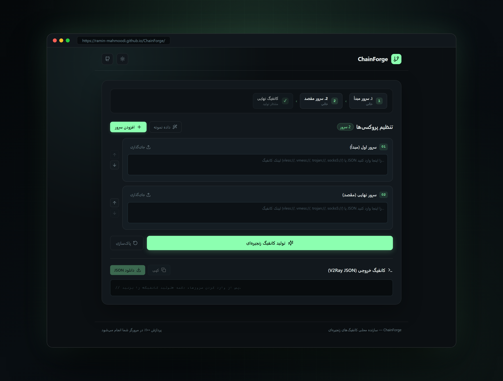

# ChainForge

**ابزار آنلاین و امن برای ساخت زنجیره اتصال پروکسی‌های V2Ray و Xray**

  
  
  

**[مشاهده و استفاده آنلاین از برنامه](https://ramin-mahmoodi.github.io/ChainForge/)**

 

---

## معرفی

پروژه **ChainForge** یک ابزار تحت وب سبک، سریع و کاملاً سمت کاربر (Client-Side) است که امکان اتصال زنجیره‌ای چندین سرور پروکسی (Proxy Chaining / Multi-Hop Relay) را فراهم کرده و فایل پیکربندی استاندارد `config.json` را برای هسته V2Ray و Xray تولید می‌کند.

در این ساختار، ترافیک ابتدا به سرور مبدأ ارسال شده و پس از عبور از سرورهای میانی، از طریق سرور مقصد به اینترنت متصل می‌شود.

---

## ویژگی‌ها و قابلیت‌ها

<ul dir="rtl">
  <li dir="rtl">
    <strong>امنیت کامل و پردازش محلی (Client-Side):</strong> 
    کلیه محاسبات، رمزگشایی‌ها و تولید فایل پیکربندی منحصراً در مرورگر کاربر انجام شده و هیچ داده‌ای به سرور خارجی ارسال نمی‌گردد.
  </li>
  <li dir="rtl">
    <strong>تشخیص خودکار پروتکل:</strong> 
    شناسایی آنی نوع پروتکل و استخراج خودکار پارامترها به محض درج لینک.
  </li>
  <li dir="rtl">
    <strong>پشتیبانی از پروتکل‌های ارتباطی:</strong>
    <ul dir="rtl">
      <li dir="rtl"><strong>پروتکل VLESS:</strong> با پشتیبانی کامل از REALITY، Vision (XTLS)، xHTTP (SplitHTTP)، WebSocket و gRPC</li>
      <li dir="rtl"><strong>پروتکل VMess:</strong> رمزگشایی خودکار رشته‌های Base64 و استخراج تنظیمات شبکه</li>
      <li dir="rtl"><strong>پروتکل Trojan:</strong> همراه با لایه‌های امنیتی TLS، REALITY و xHTTP</li>
      <li dir="rtl"><strong>پروکسی‌های SOCKS5 و HTTP:</strong> پشتیبانی از پروکسی‌های محلی و سرورهای رله</li>
      <li dir="rtl"><strong>ساختارهای JSON و Base64:</strong> امکان وارد کردن مستقیم بلوک‌های پیکربندی یا رشته‌های کدگذاری شده</li>
    </ul>
  </li>
  <li dir="rtl">
    <strong>طراحی کاربردی و بهینه:</strong>
    <ul dir="rtl">
      <li dir="rtl">رابط کاربری ساده، سبک و بدون پیچیدگی</li>
      <li dir="rtl">قابلیت تغییر تم به حالت تاریک و روشن</li>
      <li dir="rtl">کلید میانبر کیبورد (Ctrl + Enter) جهت ساخت سریع</li>
      <li dir="rtl">امکان کپی مستقیم و دانلود فایل با فرمت JSON</li>
    </ul>
  </li>
</ul>

---

## راهنمای استفاده

<ol dir="rtl">
  <li dir="rtl"><strong>ورود اطلاعات سرورها:</strong> لینک سرور مبدأ و سرور مقصد را در بخش‌های مربوطه وارد نمایید (امکان استفاده از دکمه «جای‌گذاری» وجود دارد).</li>
  <li dir="rtl"><strong>تولید پیکربندی:</strong> بر روی دکمه «تولید کانفیگ زنجیره‌ای» کلیک کنید یا کلیدهای ترکیبی Ctrl + Enter را فشار دهید.</li>
  <li dir="rtl"><strong>استفاده در کلاینت:</strong> فایل یا متن JSON تولید شده را دریافت کرده و در نرم‌افزارهای سازگار با V2Ray/Xray (نظیر v2rayN، v2rayNG، Nekoray، MahsaNG، Streisand و سایر برنامه‌ها) بارگذاری نمایید.</li>
</ol>

---

## مجوز استفاده

این پروژه تحت مجوز [MIT](LICENSE) به صورت متن‌باز منتشر شده است.

